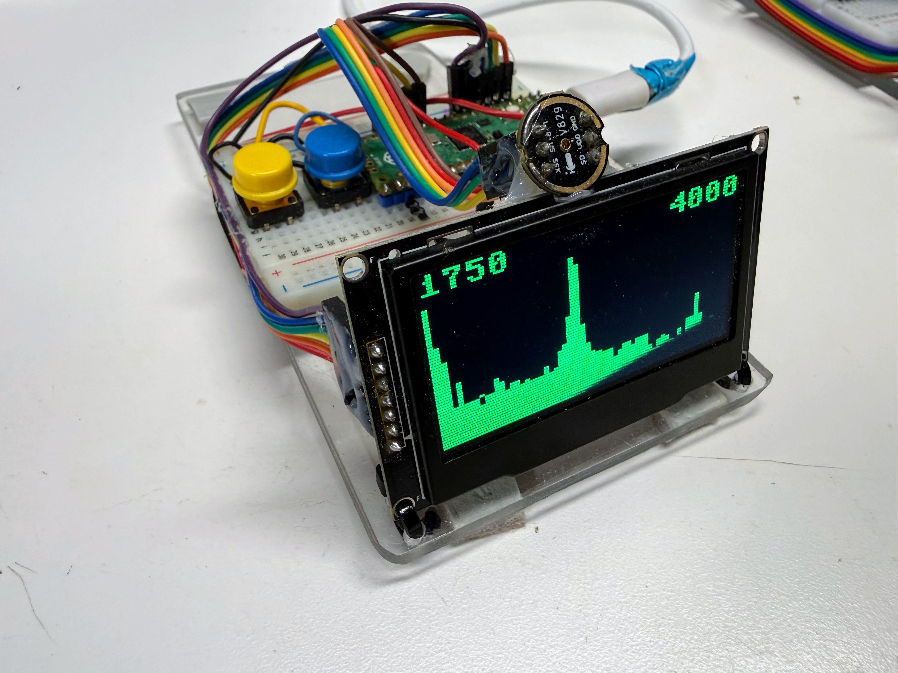
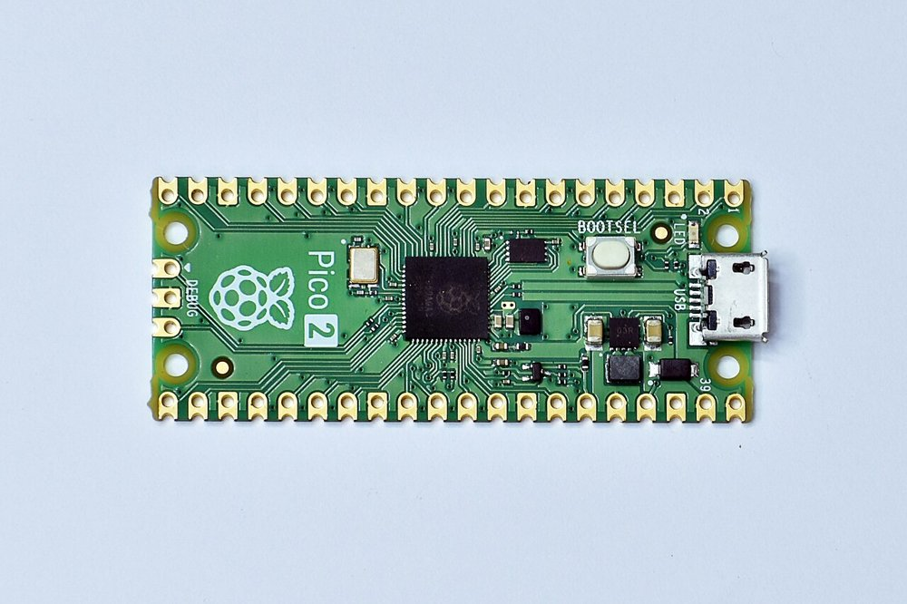
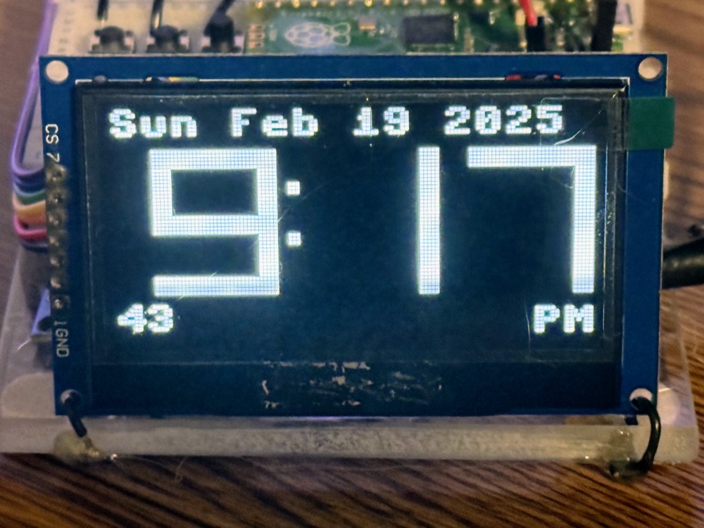
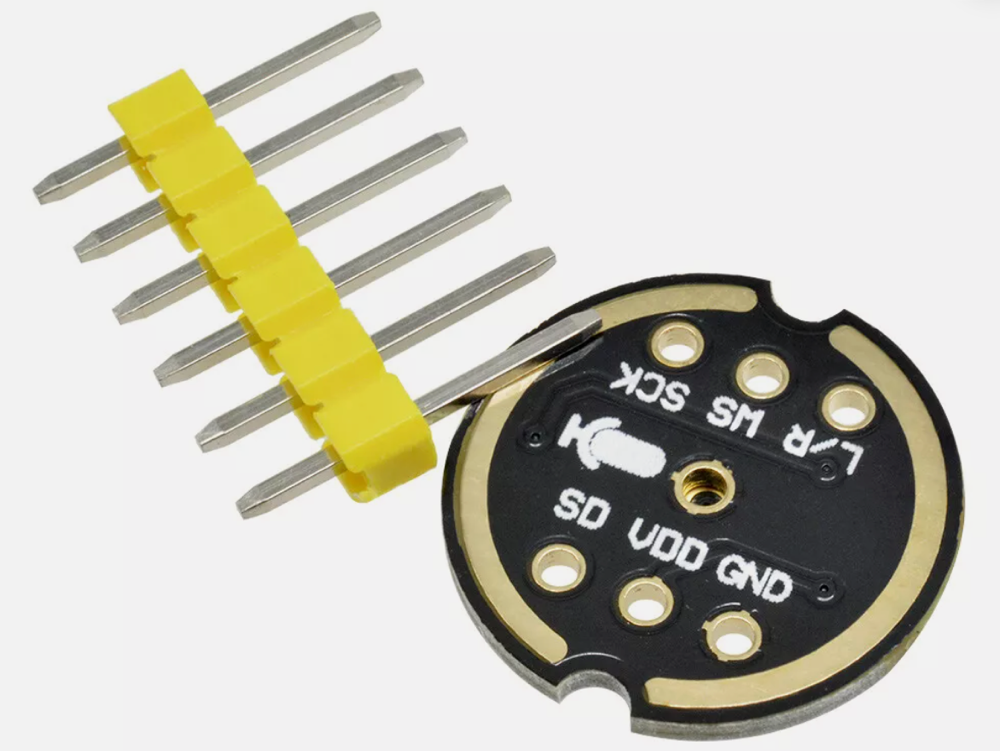
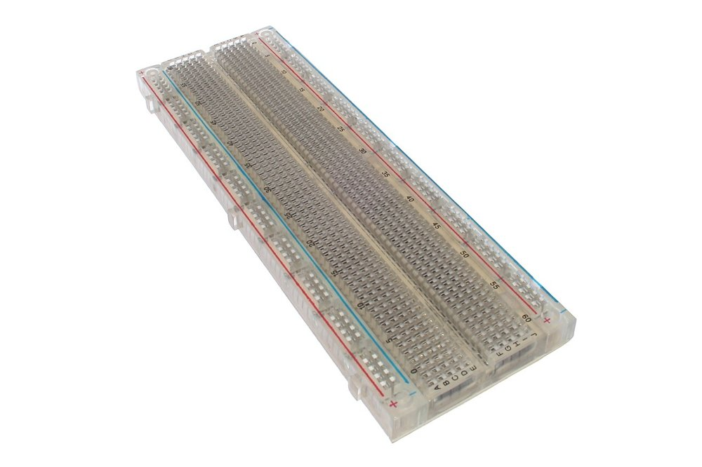
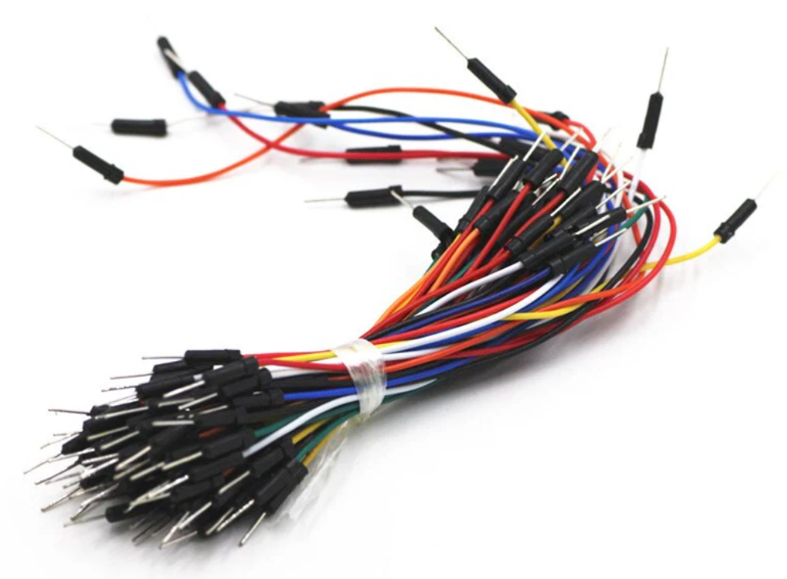
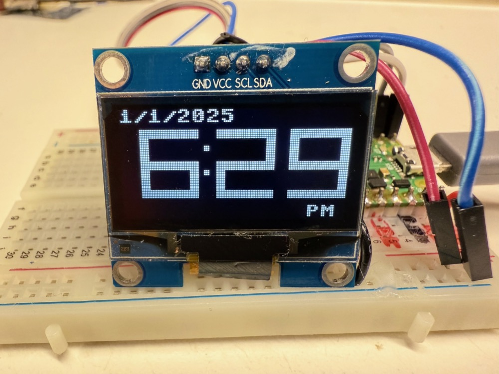
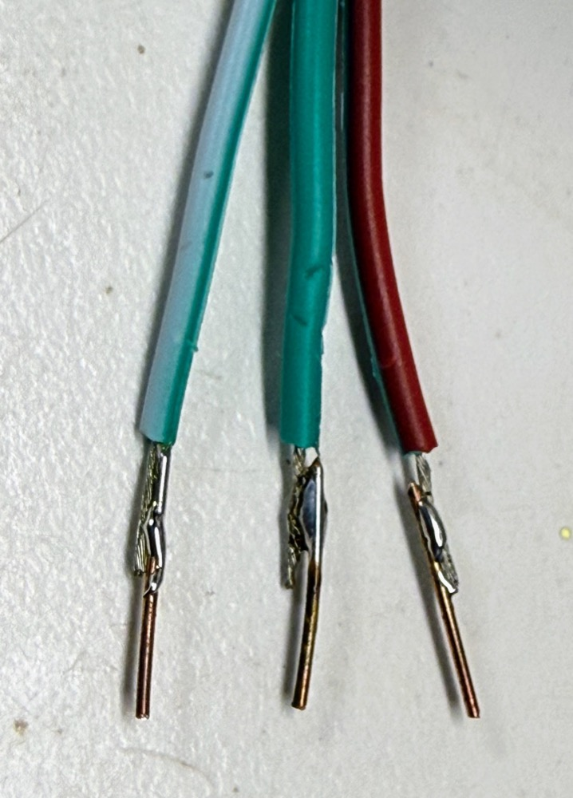

# Instructor's Guide

This page holds the Purchasing Guide section of the Instructor's Guide. Teaching notes,
module pacing and classroom logistics are in the main
[Instructor's Guide introduction](../../instructors-guide/index.md).

## Purchasing Guide

{ width="600" }

The whole course runs on a single kit, the **FFT Lab Kit**: a Raspberry Pi Pico 2, a 2.42-inch
128×64 OLED display, an INMP441 I²S microphone, two push buttons, a breadboard and wiring. Every
one of the 35 labs uses it. One kit costs about **$25** at single-unit prices, about **$19.50 per
student** for a class of 20, and about **$16 per student** at district scale (100+ students). The
cheapest route is direct from China, which took **8–15 days** in our 2026 orders, so order at
least three weeks before the term starts, and four to five weeks for a full classroom set.

!!! note "Prices checked October 2026"
    Component prices move, and marketplace listings turn over constantly. Treat every figure
    here as a planning estimate, not a quote. Prices were checked with web searches of
    Micro Center, Amazon, AliExpress, Alibaba and specialty retailers on October 18, 2026;
    figures marked *estimate* could not be confirmed from a current listing, and each one says
    how it was estimated.

!!! warning "Don't order the wrong one: Pico 2, not the original Pico"
    A **Raspberry Pi Pico 2 (RP2350)** is required. The original Pico (RP2040) looks almost
    identical in listing photos, but its Cortex-M0+ core has no floating-point unit, so
    [Labs 30–34](../../labs/30-fpu-assembly/index.md) (the FPU and assembly labs) cannot run on
    it. Look for "Pico 2" and "RP2350" in the listing title. Sellers often list both boards
    side by side, and the RP2040 Pico is cheaper, so it is the one that ends up in the cart.

### Summary of Parts List

**Required**

- [Raspberry Pi Pico 2 H](#raspberry-pi-pico-2-h) — the microcontroller every lab runs on — FFT Lab Kit (~$4.99)
- [Micro-USB Data Cable](#micro-usb-data-cable) — power and the Thonny connection — FFT Lab Kit (~$2.50)
- [2.42-inch OLED Display (SSD1309, SPI)](#242-inch-oled-display-ssd1309-spi) — the spectrum, meter and tuner display — FFT Lab Kit (~$7.20)
- [INMP441 I²S MEMS Microphone](#inmp441-i2s-mems-microphone) — the only audio input — FFT Lab Kit (~$3.00)
- [Momentary Push Buttons (6×6 mm)](#momentary-push-buttons-66-mm) — mode switching, two per kit — FFT Lab Kit (~$0.10 for two)
- [Solderless Breadboard (830 Point)](#solderless-breadboard-830-point) — holds the whole circuit — FFT Lab Kit (~$2.00)
- [Male-to-Male Jumper Wires](#male-to-male-jumper-wires) — short breadboard connections — FFT Lab Kit (~$2.00)
- [Dupont Ribbon Cable (Male-to-Female, 20 cm)](#dupont-ribbon-cable-male-to-female-20-cm) — display and microphone cables — FFT Lab Kit (~$2.95)

**Optional**

- [1.3-inch OLED Display (SH1106, SPI)](#13-inch-oled-display-sh1106-spi) — smaller, cheaper alternative to the 2.42-inch display — FFT Lab Kit (~$2.95)
- [Raspberry Pi Pico 2 W](#raspberry-pi-pico-2-w) — wireless board for the Chapter 28 wake-word extension — FFT Lab Kit (~$6.99)
- [22-Gauge Solid-Core Hookup Wire](#22-gauge-solid-core-hookup-wire) — shared classroom wire for custom wiring — FFT Lab Kit (~$14.99 per classroom)

**Estimated total per kit:**

| Kit | One kit (single-unit prices) | Per student, class of 20 | Per student, district (100+) |
|-----|------------------------------|--------------------------|------------------------------|
| FFT Lab Kit | ~$24.74 | ~$19.51 | ~$16.08 |

The course description quotes the kit at **about $20 per student**. A single kit costs more,
about $25, for two reasons: the ribbon cable and USB cable are sold in packs that serve
several kits, and single-unit shipping on the display and microphone costs more per piece.
If you buy one kit from scratch, the cash outlay is about **$35**, because you also buy a
100-pack of buttons and a 3-pack of USB cables. A classroom order of 20 lands right on the
quoted ~$20. Shared tools, such as the hookup wire, are kept out of the per-student figures.

### Raspberry Pi Pico 2 H

{ width="400" }

*Photo: Suyash Dwivedi, [CC BY-SA 4.0](https://creativecommons.org/licenses/by-sa/4.0) via [Wikimedia Commons](https://commons.wikimedia.org/wiki/File:Raspberry_PI_Pico_2_02.jpg). The photo shows the plain Pico 2; the Pico 2 H is the same board with header pins already soldered on.*

**Used in:** FFT Lab Kit (×1)

**Used for:** Every lab, starting with [Lab 1: Hello World](../../labs/01-hello-world/index.md);
[Lab 28: Does Your CPU Have an FPU?](../../labs/28-fpu-check/index.md) and
[Labs 30–34](../../labs/30-fpu-assembly/index.md) depend on its hardware FPU.

The Pico 2 is built on the RP2350: a dual-core Arm Cortex-M33 at 150 MHz with a hardware
floating-point unit and 520 KB of RAM. Every lab runs MicroPython directly on it. Buy the
**Pico 2 H** (the "H" means headers are pre-soldered) so the board itself needs no soldering. The plain
Pico 2 is a dollar cheaper but arrives with bare holes along both edges.

**Requirements:** It must be an RP2350 board with the hardware FPU. Wireless is not needed for
any of the 35 labs, so the Pico 2 W is only worth buying for the optional Chapter 28 extension.

**Prep work:** None. The Pico 2 H is breadboard-ready as shipped. If you buy the plain Pico 2
instead, solder two 20-pin male headers to it, which takes about 15 minutes per board with a
breadboard used as a jig.

**Cost:** ~$4.99 each in quantity 1 (Micro Center Pico 2 H, sale price, regularly $5.99,
in-store pickup only; the plain Pico 2 is $3.99 and ships) · ~$4.99 each in a classroom order of
20+ · ~$5.99 each at district scale (*estimate*: Raspberry Pi holds a fixed retail price, so
we found no distributor discount and assume the regular $5.99 price). Raspberry Pi lists the
Pico 2 from $5.

**Trusted sellers:** Buy from authorized resellers: Micro Center, Adafruit, SparkFun, Digi-Key
or PiShop.us. Relabeled RP2040 boards and clones do appear on general marketplaces. A genuine
board has the Raspberry Pi logo, "Pico 2" on the silkscreen, and an RP2350 chip, and the price
is close to the fixed retail price. A listing far below $4 is a warning sign.

**Search keywords:** `Raspberry Pi Pico 2 H`, `Pico 2 RP2350 with headers`, `SC1632`
(the manufacturer part number for the Pico 2 H; `SC1631` is the plain Pico 2)

**Where to buy:**

- [Search eBay for "Raspberry Pi Pico 2 H RP2350"](https://www.ebay.com/sch/i.html?_nkw=Raspberry+Pi+Pico+2+H+RP2350)
- [Search Amazon for "Raspberry Pi Pico 2 H RP2350"](https://www.amazon.com/s?k=Raspberry+Pi+Pico+2+H+RP2350)
- [Search Micro Center for "Raspberry Pi Pico 2 H RP2350"](https://www.microcenter.com/search/search_results.aspx?Ntt=Raspberry+Pi+Pico+2+H+RP2350)

---

### Micro-USB Data Cable

{ width="350" }

*Photo: Electronicgrup, [CC BY-SA 3.0](https://creativecommons.org/licenses/by-sa/3.0) via [Wikimedia Commons](https://commons.wikimedia.org/wiki/File:USB_2.0_A_MACHO_-_MICRO_USB_B_MACHO.jpg)*

**Used in:** FFT Lab Kit (×1)

**Used for:** [Lab 1: Hello World](../../labs/01-hello-world/index.md) and every lab after it.
It powers the Pico 2 and carries the Thonny connection.

The Pico 2 has a **Micro-USB** port, not USB-C. The cable has to carry **data**, not just
power. Charge-only cables look the same, and they are the most common reason a Pico "isn't
detected" on day one. Many students already own a suitable cable. If your laptops only have
USB-C ports, buy USB-C to Micro-USB cables instead.

!!! tip "Confirm it says data or sync"
    Look for "data", "sync" or "480 Mbps" in the listing. A cable sold only as a "charging
    cord" may have no data wires at all.

**Prep work:** None. Test each cable with a Pico 2 in Thonny on arrival, and label or discard
any cable that only charges.

**Cost:** ~$2.50 each in quantity 1 (Cable Matters 3-pack, $7.49 on Amazon; Amazon Basics
3-pack $9.44) · ~$2.50 each in a classroom order of 20+ (seven 3-packs) · ~$1.00 each at
district scale (*estimate*: we could not confirm a current bulk listing, so this assumes the
same roughly 60% discount we saw on the other commodity parts in China-direct bulk orders).

**Spotting a bad batch:** A charge-only cable or a loose plug shows up as a Pico 2 that is
missing from Thonny's port list. Test on arrival and replace the odd dud rather than returning
it.

**Search keywords:** `micro USB data sync cable 3ft`, `USB-A to Micro-B data cable`,
`USB-C to Micro-USB data cable`

**Where to buy:**

- [Search eBay for "micro USB data sync cable 3ft"](https://www.ebay.com/sch/i.html?_nkw=micro+USB+data+sync+cable+3ft)
- [Search AliExpress for "micro USB data sync cable 3ft"](https://www.aliexpress.com/w/wholesale-micro-usb-data-sync-cable-3ft.html)
- [Search Amazon for "micro USB data sync cable 3ft"](https://www.amazon.com/s?k=micro+USB+data+sync+cable+3ft)

---

### 2.42-inch OLED Display (SSD1309, SPI)

{ width="400" }

**Used in:** FFT Lab Kit (×1)

**Used for:** [Lab 4: The OLED Display](../../labs/04-oled-display/index.md) onward, including
[Lab 8: Sound Levels](../../labs/08-sound-levels/index.md),
[Lab 21: Spectrum of a Real Sound](../../labs/21-real-spectrum/index.md),
[Lab 23: Build a Tuner](../../labs/23-tuner/index.md) and
[Lab 24: Real-Time Spectrum Analyzer](../../labs/24-realtime-analyzer/index.md). It is the only
visual output in the kit.

This is a 2.42-inch, 128×64-pixel monochrome OLED module. We chose the 2.42-inch size over the
common 0.96-inch one because a spectrum is readable from across a table. The modules use the
**SSD1309** controller. The course's `ssd1306` MicroPython driver works with it unchanged,
and `config.py` already notes both chips. The colour (white, blue, yellow or green) is a matter
of taste.

**Requirements:** It must be the **7-pin SPI module board** (pins GND, VCC, SCL, SDA, RES, DC,
CS), because `config.py` and every wiring diagram assume SPI on GPIO 2–6.

!!! tip "Confirm the 7-pin SPI module, not a bare panel or the 4-pin I2C version"
    Two lookalikes turn up in the same search. The **4-pin** version is I2C-only and will not
    match the labs without code and wiring changes. A **bare 24-pin panel** with a thin ribbon
    (0.5 mm pitch) cannot plug into a breadboard at all. Count seven pins in the listing photo.
    Seven-pin boards ship set to SPI by default (I2C needs resistors moved), which is what you
    want.

**Prep work:** Usually none, because most 7-pin modules ship with the header already
soldered. Check the listing photo; if the header is loose, soldering it takes about 5 minutes.
The optional [wiring harness](https://dmccreary.github.io/learning-micropython/hands-on-labs/15-oled-setup/19-wiring-harness/)
described in Lab 4 takes about 10 minutes per kit and saves a lot of "my display went dark"
debugging later.

**Cost:** ~$7.20 each in quantity 1 (AliExpress, TZT 7-pin SPI listing at $7.15–$7.26; the same
module is $13.99 on Amazon for fast domestic delivery) · ~$7.20 each in a classroom order of
20+ · ~$6.50 each at district scale (factory listings at $6.41–$7.90 with a 3-piece minimum
order). This is the most expensive part in the kit, and the one where ordering ahead saves the
most.

**Spotting a bad batch:** Look for dead pixel rows, a cracked glass corner (the panel extends
past the circuit board), or a module that stays blank with known-good wiring. Run Lab 4's test
pattern on every display on arrival.

**Search keywords:** `2.42 inch OLED SSD1309 SPI 7 pin`, `2.42" 128x64 OLED module`, `12864 OLED
SSD1309`

**Where to buy:**

- [Search eBay for "2.42 inch OLED SSD1309 SPI 7 pin"](https://www.ebay.com/sch/i.html?_nkw=2.42+inch+OLED+SSD1309+SPI+7+pin)
- [Search AliExpress for "2.42 inch OLED SSD1309 SPI 7 pin"](https://www.aliexpress.com/w/wholesale-2-42-inch-oled-ssd1309-spi-7-pin.html)
- [Search Amazon for "2.42 inch OLED SSD1309 SPI 7 pin"](https://www.amazon.com/s?k=2.42+inch+OLED+SSD1309+SPI+7+pin)
- [Search Alibaba for "2.42 inch OLED SSD1309 SPI 7 pin"](https://www.alibaba.com/trade/search?SearchText=2.42+inch+OLED+SSD1309+SPI+7+pin)

---

### INMP441 I²S MEMS Microphone

{ width="350" }

**Used in:** FFT Lab Kit (×1)

**Used for:** [Lab 7: Your First Sound Capture](../../labs/07-first-sound/index.md) and every
audio lab after it:
[Lab 8](../../labs/08-sound-levels/index.md), [Lab 9](../../labs/09-aliasing/index.md),
[Lab 10](../../labs/10-bit-depth/index.md), [Lab 21](../../labs/21-real-spectrum/index.md),
[Lab 23](../../labs/23-tuner/index.md) and [Lab 24](../../labs/24-realtime-analyzer/index.md).

The INMP441 is a digital MEMS microphone with its own amplifier, filter and 24-bit ADC on
board. It sends samples straight to the Pico 2 over I²S, so it needs no analog circuitry. Buy
the **INMP441** by name. Lookalike "INMP441-compatible" modules (MS3625, MS4030) are cheaper,
but the labs were tested on the INMP441.

**Prep work:** Some minor soldering required. Most listings ship with the six-pin header
**loose**, as in the photo, and soldering the headers takes about 5 minutes per board. This
is the only soldering in the kit. Some listings are sold as
"solderless" with the header already fitted, and these are worth the extra few cents if you
want a no-solder kit. When wiring, students must not skip the L/R pin: Lab 7 ties it to GND.

**Cost:** ~$3.00 each in quantity 1 (AliExpress singles at $2.19–$4.39; an Amazon 3-pack is
$8.54–$9.99) · ~$1.00 each in a classroom order of 20+ (AliExpress listings around $0.99) ·
~$0.89 each at district scale (an Alibaba tiered listing at $0.89 for 10–999 pieces and $0.79
at 1,000+).

**Spotting a bad batch:** A dead or badly soldered microphone reads as all zeros, or as one
constant number, in Lab 7, which looks exactly like a wiring mistake. Check the solder joints
first, then swap in a spare. At $1 each, buy two or three extras rather than returning duds.

**Search keywords:** `INMP441 I2S microphone module`, `INMP441 MEMS omnidirectional`,
`INMP441 solderless`

**Where to buy:**

- [Search eBay for "INMP441 I2S microphone module"](https://www.ebay.com/sch/i.html?_nkw=INMP441+I2S+microphone+module)
- [Search AliExpress for "INMP441 I2S microphone module"](https://www.aliexpress.com/w/wholesale-inmp441-i2s-microphone-module.html)
- [Search Amazon for "INMP441 I2S microphone module"](https://www.amazon.com/s?k=INMP441+I2S+microphone+module)
- [Search Alibaba for "INMP441 I2S microphone module"](https://www.alibaba.com/trade/search?SearchText=INMP441+I2S+microphone+module)

---

### Momentary Push Buttons (6×6 mm)

{ width="250" }

**Used in:** FFT Lab Kit (×2)

**Used for:** [Lab 5: Buttons and Interaction](../../labs/05-buttons/index.md),
[Lab 6: Deploying Code](../../labs/06-deploying-code/index.md), and mode switching in the
tuner, the analyzer and the [Lab 35 capstone](../../labs/35-capstone/index.md).

Standard 6×6 mm, four-leg, through-hole tactile switches. Each button connects one GPIO pin
(GPIO 14 or 15) to GND and uses the Pico's internal pull-up, so no resistor is needed. Caps
are optional, but they make the buttons easier to press.

**Prep work:** None. They are breadboard-ready as shipped. Show students that the four legs
are two connected pairs, so a button set across the breadboard's center gap is the reliable
way to place it.

**Cost:** ~$0.10 for two in quantity 1 (a 100-pack is $4.99 on Amazon, about $0.05 each) ·
~$0.05 each in a classroom order of 20+ (one 100-pack covers 20 kits with 60 spares) · ~$0.04
each at district scale (Alibaba 4-pin 6×6 mm switches at a 1,000-piece minimum order).

**Spotting a bad batch:** Look for legs bent too short to seat, or switches that stay closed
or never click. Discard the odd bad one; the 100-pack has plenty of spares.

**Search keywords:** `6x6mm tactile push button 4 pin`, `tact switch 6x6x5 DIP`,
`momentary tactile switch`

**Where to buy:**

- [Search eBay for "6x6mm tactile push button 4 pin"](https://www.ebay.com/sch/i.html?_nkw=6x6mm+tactile+push+button+4+pin)
- [Search AliExpress for "6x6mm tactile push button 4 pin"](https://www.aliexpress.com/w/wholesale-6x6mm-tactile-push-button-4-pin.html)
- [Search Amazon for "6x6mm tactile push button 4 pin"](https://www.amazon.com/s?k=6x6mm+tactile+push+button+4+pin)
- [Search Alibaba for "6x6mm tactile push button 4 pin"](https://www.alibaba.com/trade/search?SearchText=6x6mm+tactile+push+button+4+pin)

---

### Solderless Breadboard (830 Point)

{ width="450" }

*Photo: oomlout, [CC BY-SA 2.0](https://creativecommons.org/licenses/by-sa/2.0) via [Wikimedia Commons](https://commons.wikimedia.org/wiki/File:BREB-02_(14335226011).jpg)*

**Used in:** FFT Lab Kit (×1)

**Used for:** Every wired lab from [Lab 4](../../labs/04-oled-display/index.md) on. It holds the
Pico 2, the display cable, the microphone and the buttons.

A full-size 830 tie-point breadboard, about 6.5 × 2.2 inches, often sold as "MB-102". Buy the
full size: the half-size 400-point boards used in other kits are too short to hold the Pico 2,
two buttons and two cable headers without crowding.

**Prep work:** None. It is breadboard-ready as shipped. Optionally, mark the 3V3 and GND rails
with a permanent marker, since the most expensive mistake in the course is a display wired to
5 V.

**Cost:** ~$2.00 each in quantity 1 (an Amazon 10-pack at $19.99; a single board is $6.94 from
Circuit Specialists) · ~$1.10 each in a classroom order of 20+ (AliExpress MB-102 listings at
$0.68–$2.61, most around $0.99–$1.21) · ~$0.40 each at district scale (Alibaba listings at
$0.40 for 5–49 pieces, plus a flat shipping charge).

**Spotting a bad batch:** Cheap breadboards are sometimes factory seconds. The usual defect is
a rail or row clip that is not bent properly, so wires will not seat or make only intermittent
contact. Test each board with a jumper on arrival and throw out the odd bad one. Returns are
not worth the time at $1 a board.

**Search keywords:** `830 point solderless breadboard`, `MB-102 breadboard`, `full size breadboard`

**Where to buy:**

- [Search eBay for "830 point solderless breadboard"](https://www.ebay.com/sch/i.html?_nkw=830+point+solderless+breadboard)
- [Search AliExpress for "830 point solderless breadboard"](https://www.aliexpress.com/w/wholesale-830-point-solderless-breadboard.html)
- [Search Amazon for "830 point solderless breadboard"](https://www.amazon.com/s?k=830+point+solderless+breadboard)
- [Search Alibaba for "830 point solderless breadboard"](https://www.alibaba.com/trade/search?SearchText=830+point+solderless+breadboard)

---

### Male-to-Male Jumper Wires

{ width="400" }

**Used in:** FFT Lab Kit (×1 set)

**Used for:** [Lab 4](../../labs/04-oled-display/index.md) and
[Lab 5](../../labs/05-buttons/index.md): the short breadboard-to-breadboard links for power
rails, ground and the buttons.

A mixed-length set of male-to-male jumpers with pin ends that plug straight into breadboard
rows. Each kit needs only about ten wires, so a 65-piece set can be split among several
students if you prefer.

**Prep work:** None. They are breadboard-ready as shipped.

**Cost:** ~$2.00 per set in quantity 1 (65-piece sets at $1.99–$5.50) · ~$2.00 per set in a
classroom order of 20+ · ~$1.00 per set at district scale (*estimate*: we found no current
bulk listing, so this assumes the same roughly 50% bulk discount as the ribbon cable below).

**Spotting a bad batch:** Pin ends that snap off or wobble in their crimp are the usual
defect. They cause intermittent faults that look like code bugs. Throw out any jumper whose
tip moves.

**Search keywords:** `breadboard jumper wires male to male`, `65 pcs jumper wire kit`,
`dupont jumper M-M`

**Where to buy:**

- [Search eBay for "breadboard jumper wires male to male"](https://www.ebay.com/sch/i.html?_nkw=breadboard+jumper+wires+male+to+male)
- [Search AliExpress for "breadboard jumper wires male to male"](https://www.aliexpress.com/w/wholesale-breadboard-jumper-wires-male-to-male.html)
- [Search Amazon for "breadboard jumper wires male to male"](https://www.amazon.com/s?k=breadboard+jumper+wires+male+to+male)

---

### Dupont Ribbon Cable (Male-to-Female, 20 cm)

{ width="450" }

**Used in:** FFT Lab Kit (×13 wires, about one-third of a 40-wire ribbon)

**Used for:** The 7-wire display cable in [Lab 4](../../labs/04-oled-display/index.md) and the
6-wire microphone cable in [Lab 7](../../labs/07-first-sound/index.md).

A 40-wire ribbon of Dupont jumpers, with a female socket on one end and a male pin on the
other. Peel off a strip of seven wires for the display and six for the microphone. The female
ends push onto the module's header pins, and the male ends go into the breadboard. One 40-wire
ribbon makes cables for three kits.

**Prep work:** Peel the ribbon into 7-wire and 6-wire strips. It takes about 2 minutes per
kit. Keep the strips intact, because a ribbon strip stays in pin order and is far harder to
miswire than loose jumpers.

**Cost:** ~$2.95 per 40-wire ribbon in quantity 1 (US$2.95 at PiShop; €2.49 in Europe) ·
~$1.00 per ribbon in a classroom order of 20+ (AliExpress kits from about $0.99), about $0.33
per kit · ~$0.65 per ribbon at district scale (an Alibaba listing for 40-pin 20 cm M-F), about
$0.22 per kit.

**Spotting a bad batch:** Female sockets that are too loose to grip a header pin. Test-fit one
strip on a module header when the order arrives.

**Search keywords:** `dupont jumper wire 40 pin male to female 20cm`, `M-F dupont ribbon cable`,
`40P jumper wire female male`

**Where to buy:**

- [Search eBay for "dupont jumper wire 40 pin male to female 20cm"](https://www.ebay.com/sch/i.html?_nkw=dupont+jumper+wire+40+pin+male+to+female+20cm)
- [Search AliExpress for "dupont jumper wire 40 pin male to female 20cm"](https://www.aliexpress.com/w/wholesale-dupont-jumper-wire-40-pin-male-to-female-20cm.html)
- [Search Amazon for "dupont jumper wire 40 pin male to female 20cm"](https://www.amazon.com/s?k=dupont+jumper+wire+40+pin+male+to+female+20cm)
- [Search Alibaba for "dupont jumper wire 40 pin male to female 20cm"](https://www.alibaba.com/trade/search?SearchText=dupont+jumper+wire+40+pin+male+to+female+20cm)

---

### 1.3-inch OLED Display (SH1106, SPI)

{ width="350" }

*This photo shows the 4-pin I2C version of the module. For this course, buy the 7-pin SPI version.*

**Used in:** FFT Lab Kit (optional, ×1, replaces the 2.42-inch display)

**Used for:** The same labs as the 2.42-inch display:
[Lab 4](../../labs/04-oled-display/index.md), [Lab 8](../../labs/08-sound-levels/index.md),
[Lab 21](../../labs/21-real-spectrum/index.md), [Lab 23](../../labs/23-tuner/index.md) and
[Lab 24](../../labs/24-realtime-analyzer/index.md). Some students still have this older display
from earlier kits.

The 1.3-inch module is the older, cheaper display: the same 128×64 resolution, sold in white or
blue. It costs well under half the price of the 2.42-inch display. The tradeoff is size. The
active area is about 29 × 15 mm against 55 × 27 mm, so it is **smaller and noticeably harder to
read**. A spectrum or tuner readout that is clear on the 2.42-inch screen from across a table
has to be read up close on this one.

**Requirements:** Buy the **7-pin SPI** version (GND, VCC, SCL/CLK, SDA/MOSI, RES, DC, CS) so it
matches the book's wiring on GPIO 2–6. The same listings also offer a 4-pin I2C version, which
does not match the labs without wiring and code changes.

!!! tip "1.3-inch OLEDs use the SH1106 controller: use an SH1106 driver"
    Most 1.3-inch modules use the **SH1106** controller, not the SSD1306 or SSD1309. The SH1106
    has 132 columns of display memory, but the panel shows only the middle 128. The course's
    `ssd1306` driver therefore draws everything **shifted 2 pixels**, with garbage or a stripe of
    leftover pixels at one edge. Use an SH1106 MicroPython driver instead, such as the common
    `sh1106.py`, and its SPI class (`SH1106_SPI`) in place of `SSD1306_SPI` in `config.py`.
    The wiring stays the same.

**Prep work:** Usually none, because most 7-pin modules ship with the header soldered. Check
the listing photo; a loose header takes about 5 minutes to solder. Copy `sh1106.py` to the
Pico's `/lib` folder alongside the other drivers.

**Cost:** ~$2.95 in quantity 1 (AliExpress EstarDyn "1.3 inch OLED Module" listing: $2.95 for
one, $2.79 each for 2 or more) · ~$2.65 each in a classroom order of 20+ (the same listing's
price for 5 or more) · ~$2.35 each at district scale (Alibaba 7-pin SPI SH1106 listings at
$2.30–$2.75 with a 30-piece minimum order; one supplier lists $1.98 with no minimum).

**Spotting a bad batch:** Look for a dead pixel row or a module that stays blank with
known-good wiring. If the image is shifted or shows a stripe at one edge, the module is not
faulty: you are running the SSD1306 driver on an SH1106 (see the tip above).

**Search keywords:** `1.3 inch OLED SH1106 SPI 7 pin 128x64`, `1.3" OLED module 12864 SPI`,
`SH1106 OLED 7 pin`

**Where to buy:**

- [Search eBay for "1.3 inch OLED SH1106 SPI 7 pin 128x64"](https://www.ebay.com/sch/i.html?_nkw=1.3+inch+OLED+SH1106+SPI+7+pin+128x64)
- [Search AliExpress for "1.3 inch OLED SH1106 SPI 7 pin 128x64"](https://www.aliexpress.com/w/wholesale-1-3-inch-oled-sh1106-spi-7-pin-128x64.html)
- [Search Amazon for "1.3 inch OLED SH1106 SPI 7 pin 128x64"](https://www.amazon.com/s?k=1.3+inch+OLED+SH1106+SPI+7+pin+128x64)
- [Search Alibaba for "1.3 inch OLED SH1106 SPI 7 pin 128x64"](https://www.alibaba.com/trade/search?SearchText=1.3+inch+OLED+SH1106+SPI+7+pin+128x64)

---

### Raspberry Pi Pico 2 W

<!-- TODO: image needed — see pico-2-w-image-description.md -->
*Photo pending. See the [image brief](./pico-2-w-image-description.md).*

**Used in:** FFT Lab Kit (optional, ×1, replaces the Pico 2 H)

**Used for:** The optional extension
[Chapter 28: Wake Word Detection](../../chapters/28-wake-word-detection/index.md), which hands
detected audio to a cloud service over Wi-Fi. It also runs all 35 labs exactly as the
Pico 2 does.

The wireless version of the Pico 2: the same RP2350, plus 2.4 GHz Wi-Fi and Bluetooth 5.2. Buy
it only if you plan to teach the Chapter 28 extension. Note that the onboard LED on a W board
is reached as `Pin("LED")`, and the course's `config.py` already handles this.

**Requirements:** It must be the **Pico 2 W (RP2350)**, not the older Pico W (RP2040). The same
FPU warning as the Pico 2 applies.

**Prep work:** None for the pre-soldered "WH" version. The plain Pico 2 W needs headers soldered
on (about 15 minutes).

**Cost:** ~$6.99 each in quantity 1 (Micro Center Pico 2 W) · ~$6.99 each in a classroom order
of 20+, about $2.00 more per student than the Pico 2 H · ~$6.99 at district scale
(*estimate*: we assume the fixed retail price holds, as it does for the Pico 2).

**Trusted sellers:** As for the Pico 2, buy from Micro Center, Adafruit, SparkFun, Digi-Key or
PiShop.us.

**Search keywords:** `Raspberry Pi Pico 2 W`, `Pico 2 WH`, `RP2350 wireless`

**Where to buy:**

- [Search eBay for "Raspberry Pi Pico 2 W"](https://www.ebay.com/sch/i.html?_nkw=Raspberry+Pi+Pico+2+W)
- [Search Amazon for "Raspberry Pi Pico 2 W"](https://www.amazon.com/s?k=Raspberry+Pi+Pico+2+W)
- [Search Micro Center for "Raspberry Pi Pico 2 W"](https://www.microcenter.com/search/search_results.aspx?Ntt=Raspberry+Pi+Pico+2+W)

---

### 22-Gauge Solid-Core Hookup Wire

{ width="250" }

**Used in:** FFT Lab Kit (optional, shared by the classroom)

**Used for:** Replacing a worn jumper, extending a connection, and the custom wiring students
do in the [Lab 35 capstone](../../labs/35-capstone/index.md). No lab requires it.

Solid-core 22 AWG wire holds its shape and pushes cleanly into a breadboard, unlike stranded
wire. It is usually sold as a six-colour kit of 25–30 ft spools. One kit supplies a whole
classroom for years.

**Prep work:** Cut and strip to length as needed. A pair of wire strippers per table helps.

**Cost:** ~$14.99 per six-spool kit in quantity 1 (Amazon kits at $13.59–$16.19; Adafruit's 6 × 25
ft set is $15.95) · one kit per classroom, not per student · no separate district price (buy
one kit per room).

**Search keywords:** `22 AWG solid core hookup wire kit`, `22 gauge solid wire 6 colors`

**Where to buy:**

- [Search eBay for "22 AWG solid core hookup wire kit"](https://www.ebay.com/sch/i.html?_nkw=22+AWG+solid+core+hookup+wire+kit)
- [Search Amazon for "22 AWG solid core hookup wire kit"](https://www.amazon.com/s?k=22+AWG+solid+core+hookup+wire+kit)

---

### Things You Do Not Need to Buy

- **A tone source** for [Lab 9: Sampling Rate and Aliasing](../../labs/09-aliasing/index.md)
  and the tuner lab: a free tone-generator app on a phone, or an online tone generator in a
  browser, works.
- **Software:** Thonny and MicroPython are free.

### Purchasing Strategy

**Lead time is the real tradeoff.** Direct-from-China listings on AliExpress and many eBay
sellers run 40–70% cheaper than Amazon for the same commodity part. The 2.42-inch display is
$7.20 from China against $13.99 on Amazon. Order a semester ahead and the savings are free.
Order the week before the unit starts and you pay the Amazon premium.

#### Ordering lead time

These figures are **based on our 2026 orders to Minnesota**: 75 deliveries measured from order
date to arrival.

| Source | Orders measured | Typical delivery | Notes |
|--------|-----------------|------------------|-------|
| AliExpress | 8 packages | 8–12 days (median 9) | Every 2026 package arrived within two weeks |
| eBay | 64 orders | median 9 days | US sellers 3–6 days; China sellers 8–15 days; about 10% took 15+ days, the worst 43 days |
| Digi-Key | — | 1–3 days | The fastest shipped option for authentic boards |
| Micro Center | — | same day | In-store pickup; the Pico 2 H is pickup-only |

**Our recommendation:** place AliExpress and eBay orders **at least three weeks** before you need
the parts, and **four to five weeks ahead for a full classroom set**. That way, a lost or very
late package (about one in ten eBay orders took more than 15 days) can be reordered and still
arrive in time. Use Digi-Key or Micro Center to fill last-minute gaps: a missing Pico 2, or a
few extra cables the week of the lab. Expect longer delays around Lunar New Year, when Chinese
factories and shipping largely stop for two weeks or more.

**Buy one, then buy twenty.** Order a single display and microphone from a seller first,
confirm they are the 7-pin SPI display and a genuine INMP441, then place the classroom order
with that same seller.

**Order spares.** Add 10–15% over the class count for the display, microphone and Pico 2.
Microphones get mis-soldered, someone wires a display to 5 V, and a dead station in the middle
of a lab costs more than the spare. Two spares of each module add about $29 to a class order.

**Watch the pack sizes.** Much of the classroom savings comes from pack breakpoints (buttons in
hundreds, breadboards in tens, ribbons that serve three kits), not from per-unit discounts.
Round the order up to the pack, not to the roster.

**Buy boards from authorized resellers.** Counterfeit and relabeled microcontroller boards turn
up on general marketplaces. Micro Center, Adafruit, SparkFun, Digi-Key and PiShop.us sell
genuine Pico 2 boards at the fixed retail price.

**Expect the odd bad unit, not a bad order.** The cheapest breadboards, buttons and jumpers are
sometimes factory seconds. Test on arrival and discard the occasional dud.

**District-scale orders.** For 100+ students, Alibaba factory listings bring breadboards to
about $0.40 and microphones under $0.90, at the cost of a minimum order quantity, a flat
shipping fee, and a longer lead time than the figures above.

**Check your district's purchasing rules first.** Many districts cannot reimburse AliExpress or
direct international orders and require a domestic vendor with a W-9. If that is your
constraint, the Amazon and Micro Center prices are your real prices. Plan on about $30 per
student instead of $20.

### Classroom Order Worksheet

| Part | Required? | Used in kits | Qty per student | Qty for 20 students | Est. cost for 20 |
|------|-----------|--------------|-----------------|---------------------|------------------|
| Raspberry Pi Pico 2 H | Required | FFT Lab Kit | 1 | 20 | $99.80 |
| Micro-USB data cable | Required | FFT Lab Kit | 1 | 21 (7 three-packs) | $52.43 |
| 2.42-inch OLED (SSD1309, SPI) | Required | FFT Lab Kit | 1 | 20 | $144.00 |
| INMP441 microphone | Required | FFT Lab Kit | 1 | 20 | $20.00 |
| 6×6 mm push buttons | Required | FFT Lab Kit | 2 | 100 (1 pack of 100) | $4.99 |
| 830-point breadboard | Required | FFT Lab Kit | 1 | 20 | $22.00 |
| Male-to-male jumper set | Required | FFT Lab Kit | 1 set | 20 sets | $40.00 |
| Dupont ribbon, 40-wire M-F 20 cm | Required | FFT Lab Kit | 1/3 ribbon | 7 ribbons | $7.00 |
| Pico 2 W upgrade (difference over Pico 2 H) | Optional | FFT Lab Kit | 1 | 20 | $40.00 |
| 1.3-inch SH1106 OLED (replaces the 2.42-inch display) | Optional | FFT Lab Kit | 1 | 20 | $53.00 |
| | | | | **Required subtotal** | **$390.22** |
| | | | | **With the Pico 2 W upgrade** | **$430.22** |
| | | | | **With the 1.3-inch display instead of the 2.42-inch** | **$299.22** |

**Per student:** ~$19.51 required · ~$21.51 with the Pico 2 W upgrade · ~$14.96 with the
1.3-inch display in place of the 2.42-inch ($144.00 − $53.00 saves $91.00 for 20 students). Add about $29 for two spares
each of the Pico 2 H, display, microphone and breadboard.

<!-- For district orders (100+), use the district prices in each part section:
     about $16.08 per student before shipping. -->

#### Shared classroom tools

These are bought once and reused for years, so they are kept out of the per-student figure.

| Tool | Cost | How many |
|------|------|----------|
| 22 AWG solid-core hookup wire kit | ~$14.99 | 1 per classroom |
| Wire strippers | $8–15 | 1 per table |
| Soldering iron and solder (only if you buy plain Pico 2 boards or microphones with loose headers) | $15–40 | 1 per 4–6 students |
